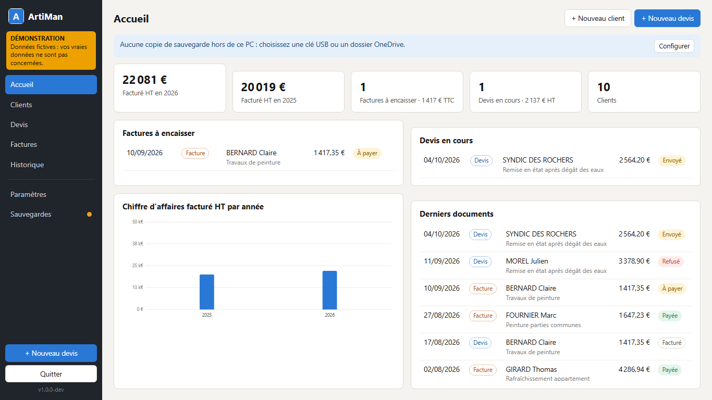
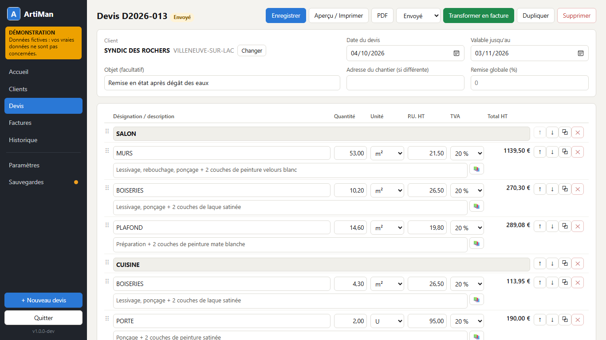
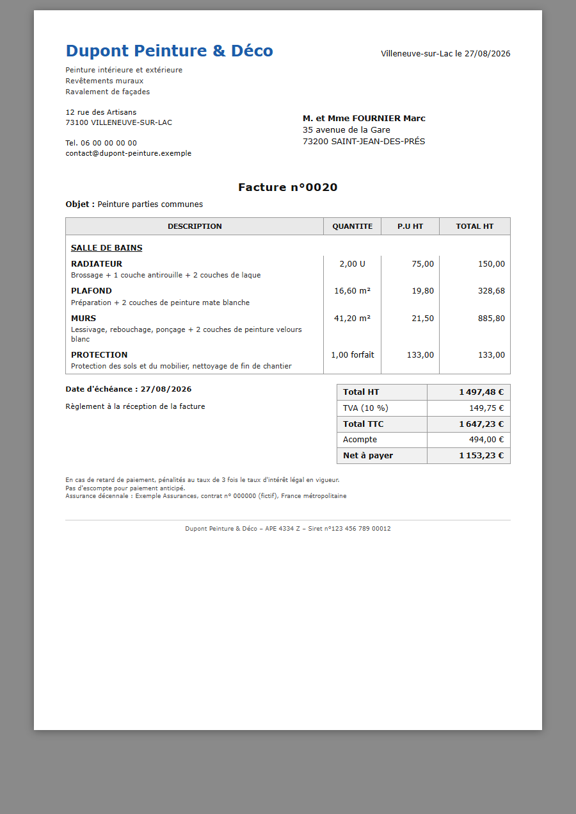

# ArtiMan

**Devis et factures pour artisans, sur votre PC. Gratuit, sans abonnement, sans Internet.**
*Quotes and invoices for French craftspeople, running locally on Windows. English section below.*

---

## 🇫🇷 Présentation

ArtiMan est un logiciel libre de devis et de factures pour les artisans (bâtiment, peinture, rénovation…).
Il fonctionne sur Windows 10 et 11, même sur un vieux PC, sans installation ni connexion Internet.
Vos données restent sur votre ordinateur.

### Ce qu'il fait
- **Clients** : fiches, recherche, import et export Excel (CSV).
- **Devis** :
  - saisie rapide au clavier, sections, bibliothèque de descriptions, remise ;
  - TVA par ligne (5,5 %, 10 %, 20 %, autoliquidation) ;
  - **franchise de TVA** pour les micro-entrepreneurs.
- **Factures** :
  - un clic pour transformer un devis en facture ;
  - acompte ;
  - numérotation continue ;
  - facture définitive une fois émise, correction par **avoir** ;
  - suivi « payée / à encaisser ».
- **PDF** automatique de chaque facture émise. Impression avec votre logo et les mentions légales (échéance, pénalités
  de retard, indemnité de 40 €, assurance décennale).
- **Sauvegardes automatiques**, copie sur clé USB ou OneDrive, restauration en un clic.
- **Tableau de bord** : chiffre d'affaires par année, factures à encaisser, recherche dans tout l'historique.

### Captures (données fictives du mode démo)

| Accueil | Saisie d'un devis | Facture imprimée |
|---|---|---|
|  |  |  |

### Installer
1. Téléchargez le dernier `ArtiMan-x.y.z.zip` dans la page [Releases](../../releases).
2. Clic droit → **Extraire tout**, dans `Documents` par exemple (pas dans `Program Files`).
3. Double-cliquez sur `ArtiMan.exe`. Un assistant vous demande les informations de votre entreprise.

Au premier lancement, Windows peut afficher « Windows a protégé votre ordinateur » : cliquez sur
**Informations complémentaires**, puis **Exécuter quand même**.
Pour découvrir le logiciel sans rien saisir, lancez **Essayer la demo.cmd** : vous travaillerez sur des données fictives,
séparées des vôtres.

Le mode d'emploi complet est dans le fichier `LISEZMOI.html`, livré avec le programme.

### ⚠️ À savoir avant de l'utiliser
- ArtiMan est fourni **gratuitement et sans garantie** (licence MIT). Vous restez responsable de vos documents
  commerciaux : faites vérifier vos mentions légales (assurance, pénalités, TVA) par votre comptable.
- **Facturation électronique** : à partir de septembre 2027, les factures entre professionnels devront être émises au
  format électronique via une plateforme agréée. ArtiMan convient aujourd'hui aux factures pour les particuliers ;
  l'export Factur-X est prévu avant cette échéance.
- ArtiMan **n'enregistre pas d'encaissements** (montants, moyens de paiement) : seulement le statut payée / à encaisser
  de chaque facture.

### Aide et idées
Les questions et suggestions se posent dans l'onglet [Discussions](../../discussions), les bugs se signalent dans
[Issues](../../issues). C'est un projet bénévole : l'aide est apportée au mieux, sans engagement.

---

## 🇬🇧 For developers

A single 32-bit Go executable serves a vanilla-JS UI on `127.0.0.1` and shows it in a Microsoft Edge `--app` window.
SQLite (`modernc.org/sqlite`, no cgo) stores everything in a `data` folder next to the executable. See
[docs/PLAN.md](docs/PLAN.md) for the design.

### Layout

| Path | Content |
|---|---|
| `cmd/artiman` | Entry point: data folder, single-instance lock, Edge window lifecycle, scheduled backups, `-demo` mode |
| `internal/domain` | Money, parsing, rounding and totals (integer cents, hundredths, basis points) |
| `internal/store` | SQLite schema (embedded migrations, triggers making issued invoices immutable), queries, search, stats |
| `internal/backup` | Backup manager (`VACUUM INTO`, retention, shrink alert, external mirror) |
| `internal/pdf` | Edge discovery, headless PDF printing, app window |
| `internal/importer` | First-run company settings, customer CSV import, legacy ArtiMan history import |
| `internal/demo` | Fictitious data for the demo mode |
| `internal/server` | JSON API, token and host guard, print pages |
| `web/static` | UI (no build step): `index.html`, `css/`, `js/` ES modules |
| `web/templates/print.html` | A4 print template, also used for the PDFs |
| `tools/build.ps1` | Release build: tests, icon and version, 386 build, ZIP |
| `tools/legacy-extraction` | Python scripts that rebuilt a legacy history from old ArtiMan `.doc` files |

### Develop

Requires Go 1.26 or later.

```powershell
go test ./...
$env:ARTIMAN_WEB_DIR = "$PWD\web\static"   # serve the UI and print template from disk (live edits)
go run ./cmd/artiman -data .\devdata -no-browser -port 8790
go run ./cmd/artiman -demo                 # fictitious data in .\demo-data
```

Then open `http://127.0.0.1:8790/`. Edge must be started from a normal Windows process: sandboxed shells may block it,
so run PDF-related manual tests from PowerShell.

### Release

Pushing a `v*` tag builds the ZIP on GitHub Actions and attaches it to the release. Locally:

```powershell
.\tools\build.ps1 -Version 1.0.0 [-PrivateDir <folder outside the repository>]
```

### Privacy

The repository contains no business identity and no customer data. Defaults are empty, the embedded icon is generic
and the tests use fictitious names. A user's own data can be bundled into a private build through `-PrivateDir`:

- `settings.json`: company identity;
- `logo.png`;
- `history.json` and `description.txt`: legacy data;
- `documents\`: original documents.

The app applies these once on first run. `data/`, `demo-data/`, `dist/` and `private/` are git-ignored: never
commit a `data` folder, it holds a customer database.

### License

[MIT](LICENSE).
